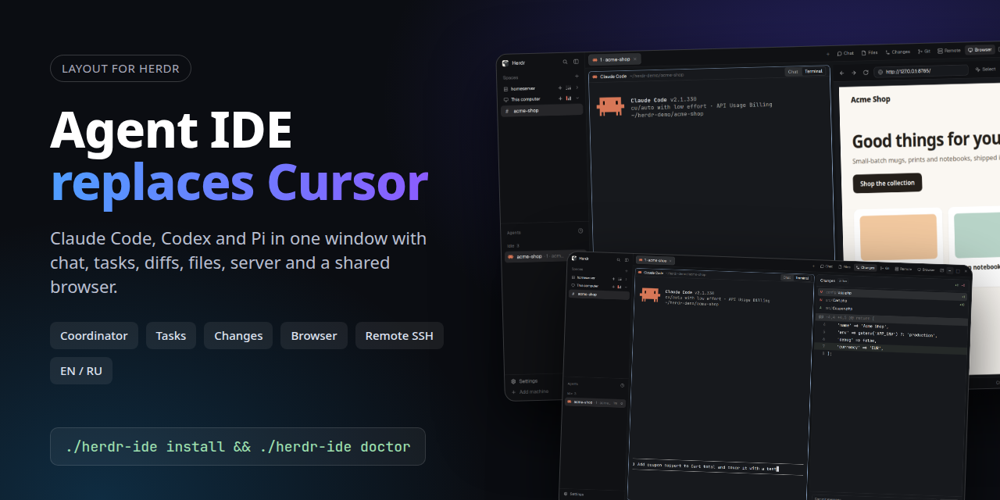
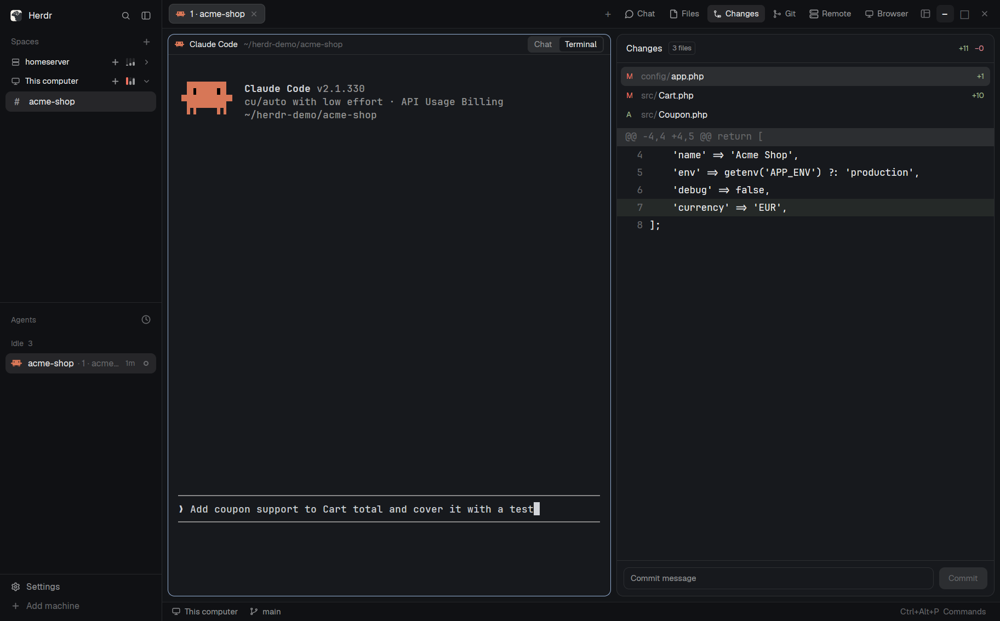
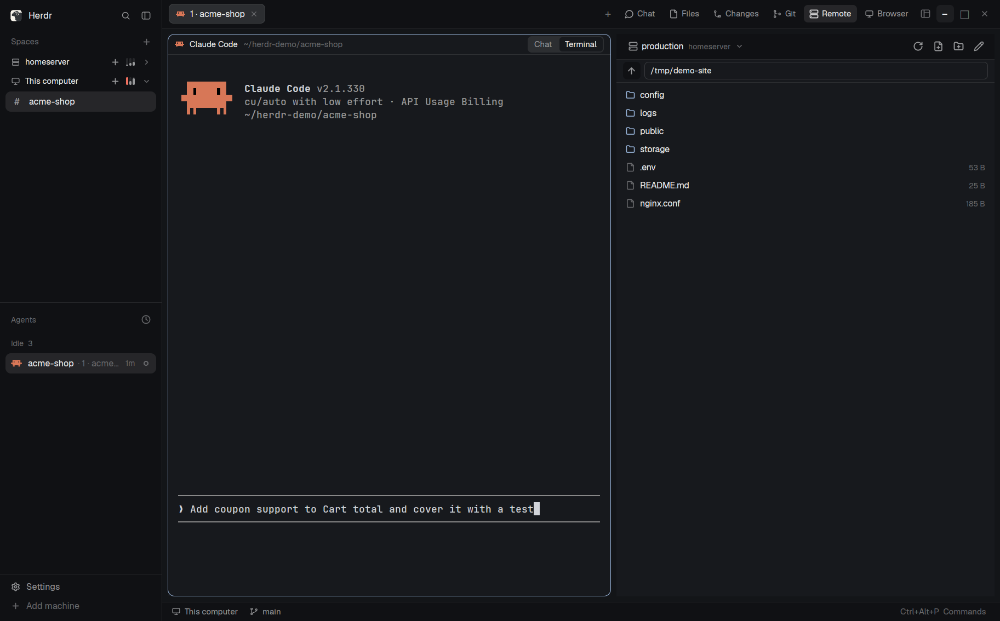
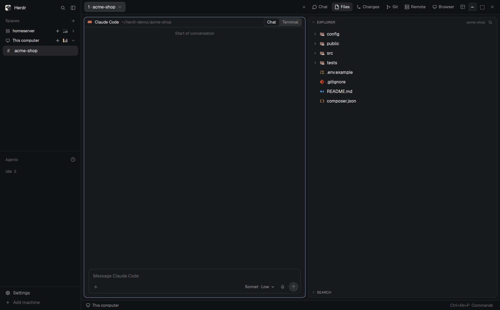

# Agent IDE for Herdr



**An agent IDE inside [Herdr](https://herdr.dev), and a replacement for Cursor's agent window.** Claude Code, Codex and Pi keep running in real terminals, and around them you get what Cursor gives you: a chat for each agent, a task board with a **Coordinator** per project, diffs and commits, a file browser and editor, your server over SSH, and a browser that you and your agents share. One window, one tab set per project, no editor to keep open next to it.

[Install](#install-in-one-command) · [What you get](#what-you-get) · [Russian and English](#russian-and-english) · [For agents](#for-agents) · [Docs](docs/CONTEXT.md)

If it saves you time, a ⭐ helps others find it.

## Install in one command

You need [Herdr](https://herdr.dev) (start it once), `node` 22+, `python3`, `git` and at least one agent CLI (`claude`, `codex` or `pi`).

```sh
git clone https://github.com/tikhomirov/herdr-agent-ide
cd herdr-agent-ide
./herdr-ide install --deps   # the layout, all 36 mods, helpers and role templates; --deps adds the browser engine
./herdr-ide doctor           # checks everything is in place and will work on this machine
herdr-app do layout.switch '{"name":"agent-ide"}'
```

- **From scratch is the normal case.** Every mod is in this repository (`lib/manifest.json` lists them); the only thing fetched besides is the file editor, from [`tikhomirov/herdr-file-editor`](https://github.com/tikhomirov/herdr-file-editor) (skip with `--no-editor`).
- **`herdr-ide doctor`** checks the tools, each mod and helper, the layout, the Russian dictionary and Herdr itself. It exits 1 when something is missing and says how to fix it.
- **`herdr-ide update`** pulls and reinstalls. An existing `layouts/agent-ide.json` is kept unless you pass `--force`.
- **Let your agent do it:** *"Add the layout from https://github.com/tikhomirov/herdr-agent-ide"*. Herdr's agents read `AGENTS.md` and `RECIPE.md`.

## Why it replaces Cursor for agent work

| In Cursor | Here |
| --- | --- |
| Agent chat | Chat view for Claude Code, Codex and Pi; the agent keeps running in its terminal, switch Chat / Terminal any time |
| Several agents, one task each | A Coordinator per project plans work, starts workers and reviewers, and keeps a task list and artifacts |
| Review the diff | Changes tab: files, diff, commit box; Git graph |
| Built-in browser | A real Chrome per project that your agents drive with `hib`; Select an element and it lands in the agent's input |
| Remote-SSH | Remote tab: edit files on your server and save them back |
| Locked to one editor | Open and scriptable: it is just Herdr mods and a Python task engine |

## What you get

### Coordinator, tasks and artifacts

Every project has a **Coordinator**: an assistant that plans, writes tasks, starts workers and reviewers in their own branches, and reports back. **Tasks** shows the list with status and branch; **Artifacts** keeps what the agents produced (reports, screenshots). **Autopilot** lets the coordinator wake on a schedule or on events and keep the project moving, deciding on its own and alerting you only on something critical; it never merges or accepts for you. Start gates hold new agents back when the machine is busy (CPU, disk).

### Files

Browse the project and open a file in an editor tab with syntax highlighting.


### Changes

The files the agent touched, the diff, and a commit box.



### Remote: the project on your server, over SSH

Pick a server (an alias from `~/.ssh/config`, or `user@host`) and a folder per project. Browse the tree, open a file in an editor tab, edit it and **save it back to the server** (it refuses to overwrite a file that changed meanwhile). Create, rename and delete files and folders. Key or ssh-agent sign-in only: nothing is stored but the server's name and folder.



### Browser: one per project, shared with your agents

A real Chrome, drawn in the panel. Your agents drive the same page with one command (`hib`), so you watch them work instead of chasing Playwright windows.


- **Select**: click an element or draw a region on the page; a short line pointing at a file with the selector, HTML, text and a screenshot is typed into your agent's input (not sent).
- **Toolbar like Cursor's**: back, forward, reload, address bar, screenshot, and a "…" menu with Hard Reload, Copy Current URL, Clear Cookies / Cache / Site Data and Open in a Chrome window.
- **Device mode**: responsive width × height, presets (iPhone, Pixel, iPad, laptop, desktop), rotate. Phones get touch and a mobile user agent.


### Chat with Claude Code, Codex and Pi

`install.sh` ships the chat mods with the layout, so agent panes get a **Chat / Terminal** switch and the tab bar a **Chat** button: the same agent shown as a conversation, with a message box under it. The agent keeps running in its terminal. The button works in any space: with a chat already shown it does nothing, with an agent in a terminal it switches that agent to its chat, and with no agent in the tab it starts Claude Code in a new tab and shows it as a chat.



Pi is the third agent in the same chat menu as Claude Code and Codex. Settings has its own **Pi** page: which provider Pi starts on, and which of its models are on. Keys stay in `~/.pi/agent/models.json`.

The Remote toolbar has an **SSH terminal** button: it opens a terminal tab on the server in the selected folder (or the one shown), on the already open connection when there is one. Unlike the tree, the terminal may ask for a password.

### Rename with emoji

Double-click a tab to rename it in a dialog with an emoji picker (Recent, Work, Faces, Nature, Symbols). The emoji becomes the first character of the name; picking another swaps it, **No emoji** removes it. Herdr's own right-click Rename still opens its plain prompt.

### Layout switcher

A button at the end of the tab bar lists your layouts and switches between them.

## More

### Optional

- Git graph ships as `mods/git-graph` (MIT, rabeeh-ta/herdr-git-graph).
- The file editor mod comes from our fork of werlang/herdr-file-editor (no licence upstream; see THIRD_PARTY.md).

## Russian and English

The whole interface, including Settings, the Coordinator, tasks and the chat, speaks Russian and English. The **RU / EN** button in the sidebar's top row switches it. Sentences with values (`Next in {0} min`) go through one function, so they translate whole. To add a language or fix a phrase, edit `i18n/ru.js` and run `python3 tools/localize.py && ./herdr-ide install`.

## Tags

herdr · herdr-layout · agent-ide · claude-code · codex · pi · cursor-alternative · ai-agents · multi-agent · coordinator · tasks · terminal · ssh · browser-automation

## For agents: `hib`

```sh
hib open http://localhost:8000     # run from the project's folder; the project = git root's folder name
hib snapshot -i                    # accessibility tree with @refs
hib click @e3
hib screenshot /tmp/shot.png
```

`hib` is [agent-browser](https://github.com/vercel-labs/agent-browser) on the project's own session and profile. If you are using the page, acting commands exit with code 4 until you are idle for 20 seconds.

## What's in the repo

The full list of mods is `lib/manifest.json`; the map with explanations is [docs/CONTEXT.md](docs/CONTEXT.md). Highlights:

| Path | What |
| --- | --- |
| `layouts/agent-ide.json` | the one layout: Herdr's `main` plus the right panel, the coordinators, tasks, artifacts and the assistant chat |
| `THIRD_PARTY.md` | Shepherdr and git-graph, MIT, with the commits they were taken from |
| `mods/tabs-ide` | the tab bar with the panel buttons, the Chat button and the layout button (a clone of Herdr's `tabs`) |
| `mods/agents-ide` | the Agents list (a clone of Herdr's `agents`) that also lists agents shown as a chat |
| `mods/rename-dialog` | the rename dialog with the emoji picker |
| `mods/layout-switcher` | the layout list dialog |
| `mods/ide-browser` | starts/stops the viewer for the shown project; `viewer.js` (the browser view), `hib` (CLI for agents), `start.html` |
| `mods/ide-browser-bar` | the browser toolbar |
| `mods/ide-browser-menu` | the "…" and preset menus |
| `mods/remote-files` | the Remote tab: server picker, tree, editor tab; `ssh.js` is the SSH layer (OpenSSH ControlMaster, no dependencies) |
| `skills/herdr-ide-browser` | the skill for agents |
| `docs/` | the screenshots above |
| `RECIPE.md` | the brief the layout can be rebuilt from (the Herdr gallery format) |

## Limits

The browser is streamed as 12 fps pictures, so there is no smooth animation; Chrome stays open per project (memory); text from Select is typed but never sent; Remote has no upload/download yet. See "Watch out" in [RECIPE.md](RECIPE.md).

The screenshots show a demo project (`acme-shop`) and a throw-away folder on a test server.

MIT licensed.

## Contributing and working on it with an agent

Start an agent in this folder and give it [docs/CONTINUE_PROMPT.md](docs/CONTINUE_PROMPT.md). [docs/CONTEXT.md](docs/CONTEXT.md) has the map of the repo, the pitfalls and the open work; `AGENTS.md` has the rules and how to install or update on a machine where the person changed things. Check a change with `herdr-app status`, `./herdr-ide doctor` and `bash tools/check.sh`.
