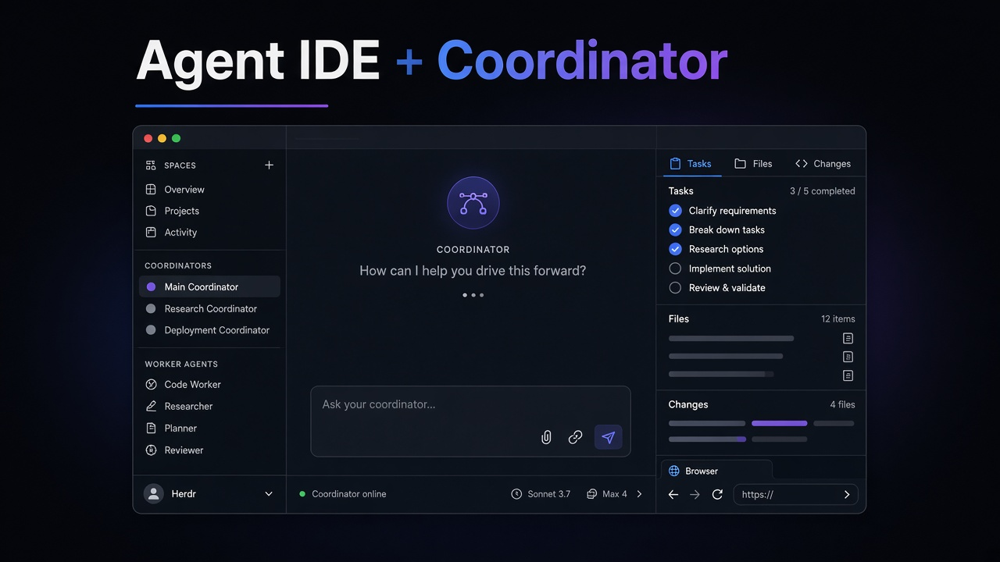
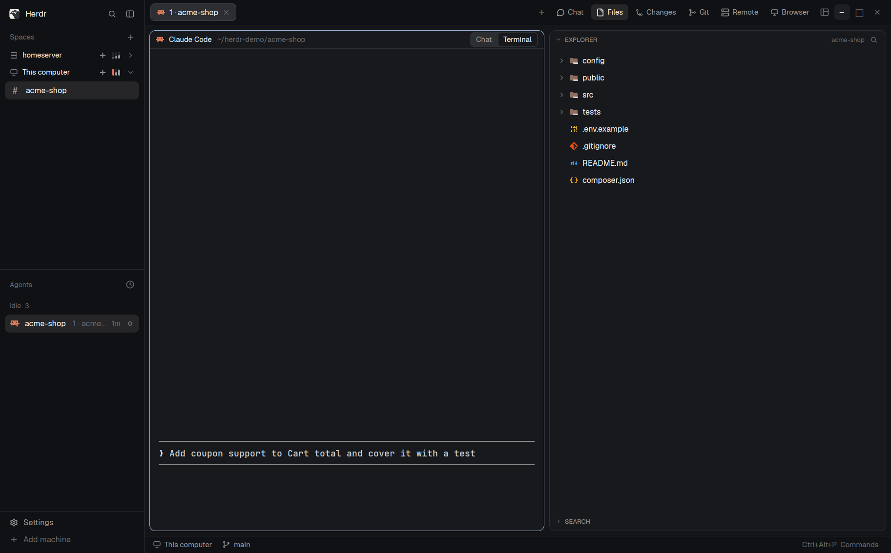
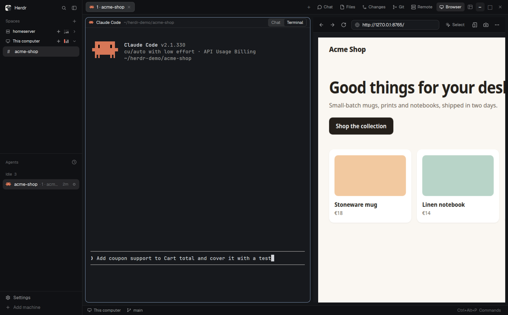
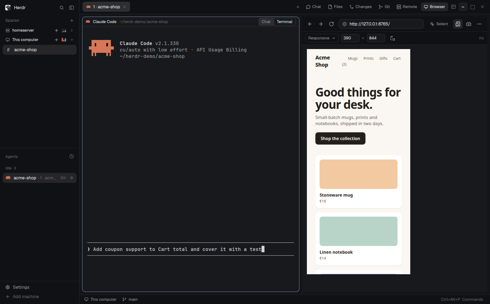

# Agent IDE for Herdr



> **New:** `layouts/ide-coord.json` adds a per-project **Coordinator** (Assistant chat + Tasks + Artifacts). See RECIPE.md, "Agent IDE + Coordinator".

**A layout for [Herdr](https://herdr.dev) that turns the window into an IDE for coding agents.** Your agents (Claude Code, Codex, Pi, …) stay in their terminals on the left. On the right is a panel with everything you reach for while they work: what they changed, the project's files, the same project on your server, and a real browser that you and your agents share.


## Why it's useful

When an agent works on a web project you keep switching windows: a terminal for the agent, an editor to read its changes, a browser to check the result, an SSH or FTP client for the server. This layout puts all of it in one window, one set of tabs per project:

- **See what the agent did**, file by file, and commit it, without leaving Herdr.
- **Check the result in a browser the agent also drives.** You both look at the same page; you can point at an element and it lands in the agent's input.
- **Fix a config on the server** (nginx, `.env`, `wp-config.php`) without a separate FTP client or an SSH session.
- **Switch project, switch everything**: every Herdr space has its own browser (its pages, sign-ins and cookies) and its own server.

## What's in the window

The window is Herdr's own `main` layout (spaces and agents on the left, tabs on top, status bar at the bottom) plus a right-hand panel with tabs, chosen by buttons at the right end of the tab bar.

### Files

Browse the project and open a file in an editor tab with syntax highlighting.



### Changes

The files the agent touched, the diff, and a commit box.


### Remote: the project on your server, over SSH

Pick a server (an alias from `~/.ssh/config`, or `user@host`) and a folder per project. Browse the tree, open a file in an editor tab, edit it and **save it back to the server** (it refuses to overwrite a file that changed meanwhile). Create, rename and delete files and folders. Key or ssh-agent sign-in only: nothing is stored but the server's name and folder.


### Browser: one per project, shared with your agents

A real Chrome, drawn in the panel. Your agents drive the same page with one command (`hib`), so you watch them work instead of chasing Playwright windows.



- **Select**: click an element or draw a region on the page; a short line pointing at a file with the selector, HTML, text and a screenshot is typed into your agent's input (not sent).
- **Toolbar like Cursor's**: back, forward, reload, address bar, screenshot, and a "…" menu with Hard Reload, Copy Current URL, Clear Cookies / Cache / Site Data and Open in a Chrome window.
- **Device mode**: responsive width × height, presets (iPhone, Pixel, iPad, laptop, desktop), rotate. Phones get touch and a mobile user agent.



### Chat with Claude Code (optional)

With Shepherdr's chat mods installed (`pane-chat`, `spaces-chat`, `workspace-status-chat`), `install.sh` gives agent panes a **Chat / Terminal** switch and the tab bar a **Chat** button: the same agent shown as a conversation, with a message box under it. The agent keeps running in its terminal. The button works in any space: with a chat already shown it does nothing, with an agent in a terminal it switches that agent to its chat, and with no agent in the tab it starts Claude Code in a new tab and shows it as a chat.


The Remote toolbar has an **SSH terminal** button: it opens a terminal tab on the server in the selected folder (or the one shown), on the already open connection when there is one. Unlike the tree, the terminal may ask for a password.

### Rename with emoji

Double-click a tab to rename it in a dialog with an emoji picker (Recent, Work, Faces, Nature, Symbols). The emoji becomes the first character of the name; picking another swaps it, **No emoji** removes it. Herdr's own right-click Rename still opens its plain prompt.

### Layout switcher

A button at the end of the tab bar lists your layouts and switches between them.

## Install

```sh
git clone https://github.com/tikhomirov/herdr-agent-ide
cd herdr-agent-ide
./install.sh --hib          # copies the mods and the layout, links `hib` into ~/.local/bin
npm i -g agent-browser && agent-browser install     # the browser engine
herdr-app do layout.switch '{"name":"ide"}'
```

Or let your agent do it: *"Add the layout from https://github.com/tikhomirov/herdr-agent-ide"* (Herdr's agents read `RECIPE.md` and the files).

Requirements: Herdr (run once so `~/.config/herdr-app` exists), `node` 22+, `git`, [agent-browser](https://github.com/vercel-labs/agent-browser) for the Browser tab, and `ssh` with a key or agent for Remote. Developed and tested on Linux.

`install.sh` never replaces an existing `layouts/ide.json` unless you pass `--force`. It replaces its own mods (`ide-browser`, `ide-browser-bar`, `ide-browser-menu`, `remote-files`, `tabs-ide`, `agents-ide`, `layout-switcher`).

Give your agents the skill so they use the browser: copy `skills/herdr-ide-browser` to `~/.agents/skills/` (or `~/.claude/skills/`).

### Optional

- A better file tab: install [`werlang/herdr-file-editor`](https://github.com/werlang/herdr-file-editor) and put `{"mod":"file-editor"}` in the `files` block of `layouts/ide.json`: clicking a file opens it in an editor tab with syntax highlighting.
- A Git graph tab: any mod with the id `git-graph` in the panel's stack gets a button automatically.

## For agents: `hib`

```sh
hib open http://localhost:8000     # run from the project's folder; the project = git root's folder name
hib snapshot -i                    # accessibility tree with @refs
hib click @e3
hib screenshot /tmp/shot.png
```

`hib` is [agent-browser](https://github.com/vercel-labs/agent-browser) on the project's own session and profile. If you are using the page, acting commands exit with code 4 until you are idle for 20 seconds.

## What's in the repo

| Path | What |
| --- | --- |
| `layouts/ide.json` | the layout: Herdr's `main` plus the right panel |
| `mods/tabs-ide` | the tab bar with the panel buttons, the Chat button and the layout button (a clone of Herdr's `tabs`) |
| `mods/agents-ide` | the Agents list (a clone of Herdr's `agents`) that also lists agents shown as a chat |
| `mods/rename-dialog` | the rename dialog with the emoji picker |
| `mods/layout-switcher` | the layout list dialog |
| `mods/ide-browser` | starts/stops the viewer for the shown project; `viewer.js` (the browser view), `hib` (CLI for agents), `start.html` |
| `mods/ide-browser-bar` | the browser toolbar |
| `mods/ide-browser-menu` | the "…" and preset menus |
| `mods/remote-files` | the Remote tab: server picker, tree, editor tab; `ssh.js` is the SSH layer (OpenSSH ControlMaster, no dependencies) |
| `skills/herdr-ide-browser` | the skill for agents |
| `docs/` | the screenshots above |
| `RECIPE.md` | the brief the layout can be rebuilt from (the Herdr gallery format) |

## Limits

The browser is streamed as 12 fps pictures, so there is no smooth animation; Chrome stays open per project (memory); text from Select is typed but never sent; Remote has no upload/download yet. See "Watch out" in [RECIPE.md](RECIPE.md).

The screenshots show a demo project (`acme-shop`) and a throw-away folder on a test server.

MIT licensed.
