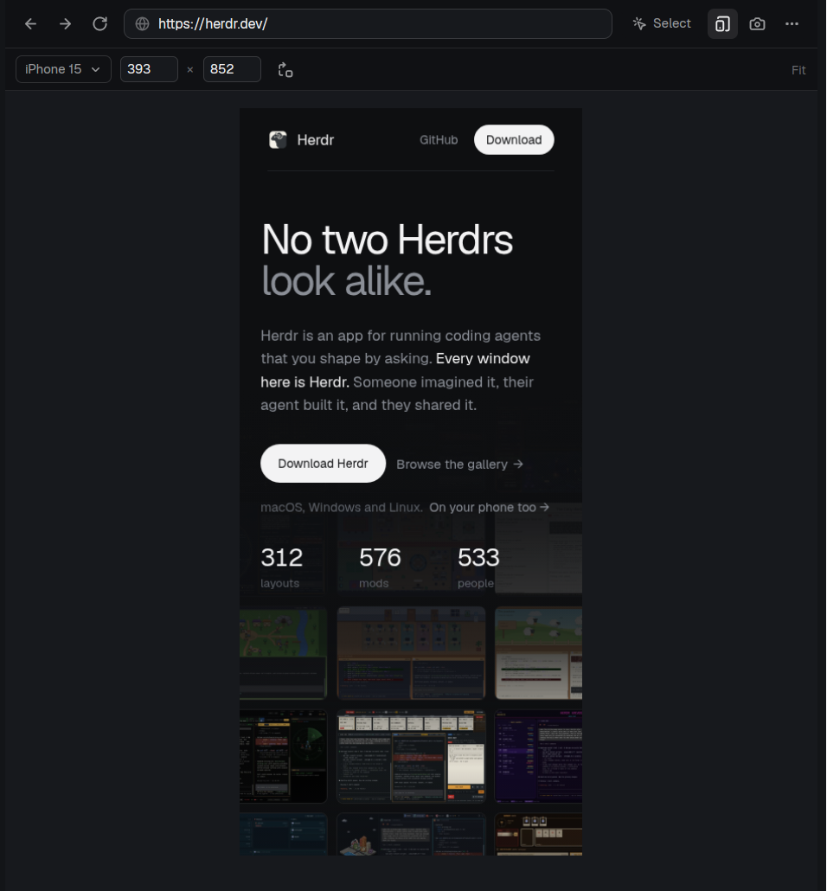

# Agent IDE

Herdr's main layout with a right-hand panel for working with coding agents the way an agent IDE does: **Files**, **Changes** and a real **Browser** that you and your agents share. Every project (space) has its own browser. You can click, scroll and type in it, point an element or a region out to the agent, take screenshots, and look at the page at phone or tablet size. A button in the tab bar switches layouts.

## What you see

The window is Herdr's `main` layout: a 268px sidebar on the left (brand row, Spaces, Agents, footer), the tab bar on top of the work area (42px, `tabs-ide`), the active tab's panes, and the status bar (28px) at the bottom.

Right of the panes there is a 460px panel (min 280, max 1000). Buttons at the right end of the tab bar, after the `+`: **Chat**, then **Files** (file icon), **Changes**, **Git**, **Remote** (server icon) and **Browser** (monitor icon), and then a layout switcher button (layout icon). The selected panel button is highlighted (`selected` color). A tab with no mod in this layout gets no button. Chat is a button, not a panel: it turns the focused agent into a chat. Git is the `git-graph` panel. Remote is the SSH file manager.

The **Remote** tab (`mods/remote-files`, a `remote` block in `panel-body`) shows the project's folder on a server over SSH. A project is a space's `folder`; its servers (`name`, `host`, `path`) are kept in the mod's `localStorage` under `projects[folder]`. With none, the tab shows a form (name, server with chips for the aliases in `~/.ssh/config`, folder). Header: server switcher, refresh, new file, new folder, edit server; below it the parent button and an editable path, then the list (click a folder to enter it, a file to open it; right click selects an entry to rename or delete it). A file opens as a tab (`tab.new` with `mod: "remote-files"` and `props.edit = {host, path, remote}`) holding an `Editor` with the language from the extension; Save or Ctrl+S writes it back atomically and with the owner and mode kept; if the file changed on the server since it was opened, saving stops and offers Overwrite or Reload. `ssh.js` runs `ssh` (BatchMode, so no password prompts) through `exec`, over a background master connection (`ControlMaster=yes -fN`, `ControlPersist=300`, started apart with its stdio closed: one started by a call keeps that call's pipes open and the call never returns).

The pane header is `pane-chat`. Agent panes show a Chat / Terminal switch, and `tabs-ide` draws a **Chat** button (chat icon, left of the panel buttons). `tabs-ide` decides by itself what it does, in any space: a `chat` pane already in the shown tab gets the focus and nothing else happens; else the tab's Claude Code / Codex pane is focused and `pane-chat.toggle` turns it into a chat (mod `chat`); with no such agent in the tab, `tab.new {argv:["claude"]}` starts one and, once it reports as an agent, the same toggle follows (a new pane's header ignores a toggle for 2 s, so it waits). A chat's agent is parked (it has no pane), and Herdr's shipped `agents` list leaves out agents without a pane, so the layout uses `agents-ide`: the `agents` mod plus the terminals labelled `herdr.chat=<chat pane>` (the label `pane-chat` writes), listed with the chat pane as their `pane`. Renaming a tab by double click opens the dialog and the mouse release that follows must not select the tab, or the pane takes the keyboard from the dialog (`tabs-ide` skips that release).

The **Browser** tab is two parts:

- A toolbar, 44px, in the app's own colors (`chrome` background, `border` line below): back, forward and reload (28px rounded buttons), an address field (28px, 8px radius, `input` border, `accent` border while focused, a globe icon at its left), a **Select** button with a pointer icon, a device button, a camera button and a "…" button.
- Below it the page, drawn edge to edge in the panel (a real Chrome, streamed as pictures).

With the device button on, the toolbar grows by a 40px row: a preset button ("Responsive", "iPhone 15", …) with a chevron, a width field, "×", a height field, a rotate button and the word "Fit" at the right. The page is then laid out at that size and drawn centered, shrunk to fit when it is bigger than the panel.

## How it behaves

- Showing the Browser tab starts the project's viewer; hiding the tab, or switching to a space of another project, stops the viewer (the Chrome behind it stays open, with its page, sign-ins and cookies). Switching back shows that project's own browser. A project is the git root's folder name of the space's folder (else the folder's name), lower-cased, `[a-z0-9_-]`, at most 24 characters.
- The address field: Enter goes there. `localhost` and `127.0.0.1` get `http://`, `*.localhost` and bare domains get `https://`, anything else is a Google search. Ctrl+L inside the page focuses the field. While a note is shown (messages like "Hard reload") it replaces the address for 6 seconds.
- Back / forward / reload are the buttons or Alt+←, Alt+→, Ctrl+R / F5 inside the page.
- Mouse (click, double click, drag, wheel), the keyboard, Ctrl+A/C/X/Z/Y, paste (Ctrl+V and terminal paste) all go to the page. What is copied in the page lands on the desktop clipboard.
- **Select** turns on a mode where the page gets no clicks: hovering outlines the element under the pointer in blue with its tag, id, classes and size; a click picks it, dragging draws a region. Either way a screenshot is saved under `~/.local/state/herdr-ide/annotations/`. For an element the details (`[Browser element on <url>]`, selector, HTML, text, attributes, screenshot path) are written to `annotations/element-<time>.md`; a short line, `browser element <path> `, is typed (not sent) into the input of the agent of the shown tab with `hc keys` (no clipboard and no window focus needed); for a region the line points at the screenshot. The full text is also put on the clipboard. With no agent in the space only the clipboard gets it. Esc leaves Select.
- The camera button saves a PNG of the page to `~/Pictures/herdr-screenshots/` and copies it to the clipboard.
- The "…" menu: Take Screenshot, Screenshot to Agent (types the file's path into the agent's input the same way), Hard Reload (cache ignored), Copy Current URL, Open in Chrome Window (a headed Chrome on the same session), Clear Cookies, Clear Cache, Clear Site Data (the current site only).
- Device mode: the preset button opens a menu: iPhone SE 375×667, iPhone 15 393×852, Pixel 7 412×915, iPad mini 768×1024, iPad Pro 11 834×1194, Laptop 1280×800, Desktop 1920×1080. Typing a width and a height and pressing Enter sets any size from 200 to 4000; the rotate button swaps them; the device button turns the mode off. Pages narrower than 768px get touch emulation, a mobile user agent and 2x pixels.
- While you use the page, a file in `~/.local/state/herdr-ide/` marks it as yours; agents using `hib` get exit code 4 for acting commands until you have been idle 20 seconds.
- Agents drive the same browser with the `hib` command (`hib open <url>`, `hib snapshot -i`, `hib click @e3`, `hib screenshot`…); you watch it happen.
- The layout switcher button opens a dialog listing every layout; the active one says "✓ Active"; Up/Down/Enter choose, Esc closes.
- Agent status (working, blocked, done, idle) shows as in Herdr's own tabs and sidebar; nothing about it changes.

## Built from

`layouts/ide.json`: a clone of the shipped `main` layout (0.1.17). `root` row → `sidebar` column (`workspace-chrome`, `spaces`, `agents`, `workspace-chrome` footer) and `work` column: `tabs` block with `{"mod":"tabs-ide"}` (px 42), `work-body` row with `main` (the active tab's panes) and `panel` column (px 460) holding a `stack` `panel-body` with children `files` (`{"mod":"files"}`), `changes` (`{"mod":"changes"}`), `git-graph` (`{"mod":"git-graph"}`), `remote` (`{"mod":"remote-files"}`) and `browser`, a column of `browser-bar` (block, px 44, `ide-browser-bar`) and `browser-host` (block, `ide-browser`); then the `status` block. A person with a different file editor mod can put it in the `files` block (the `file-editor` mod from `werlang/herdr-file-editor` opens clicked files in tabs).

Mods (`mods/<name>/`, all `place: none`):

- `agents-ide`: a clone of the shipped `agents` mod (0.1.17) with `parkedAgents()` added to `agents()`.
- `tabs-ide`: a clone of the shipped `tabs` mod (0.1.17) plus the panel buttons for the stack's children that exist (`files`, `changes`, `git-graph`, `remote`, `browser`; the icons come from the shipped `files`, `changes`, `workspace-chrome` mods, and from `git-graph` when present) and the layout switcher button (`openOverlay({mod:"layout-switcher",kind:"dialog",width:340,height:302})`). `run("layout.select"/"layout.show"/"layout.hide")` open and close the panel; it remembers the open panel per space in `localStorage`.
- `layout-switcher`: a dialog listing `layouts()`, `run("layout.switch",{name})`.
- `ide-browser`: the block inside the `browser` column. While the Browser tab is shown it runs `hc run --bg --json --cwd <folder> --label herdr.ide-view=<project> -- node mods/ide-browser/viewer.js --task <project>` and rewrites `layouts/<current layout>.json` so the `browser` column is `[browser-bar, browser-host (px 0), browser-view {terminal: <address>}]`; when the tab hides, the space or project changes, or the terminal ends, it kills the terminal and writes `[browser-bar, browser-host]` back. A ticker (every 2 s) does this; it also removes a `browser-view` left by an earlier run and publishes `shared("ide-browser") = {task}` for the toolbar. Uses `hc`, `exec("git", ["-C", folder, "rev-parse", "--show-toplevel"])`, `readTextFile`/`writeTextFile`.
- `ide-browser-bar`: the toolbar; icons (Lucide-style SVGs) in its folder; `InputState`/`Input` for the address and the size fields; talks to the viewer through `~/.local/state/herdr-ide/<project>.ctl` (commands appended, one per line: `nav <url>`, `back`, `forward`, `reload`, `hardreload`, `select`, `window`, `device <w> <h>` / `device off`, `screenshot [agent]`, `copyurl`, `clearcookies`, `clearcache`, `clearsite`) and `<project>.state.json` (written by the viewer every 2 s and on change: `url`, `title`, `live`, `select`, `device`, `note`, `noteAt`, `focusAddr`; older than 8 s = offline). Resizes its own block with `layout.resize {id:"browser-bar", px: 44 | 84}` as device mode turns on and off.
- `remote-files`: described above; `main.js` (panel and editor in one `View`, told apart by `props().edit`), `ssh.js`, SVG icons.
- `ide-browser-menu`: popup (`openOverlay kind popup`) for the "…" menu and the presets; a choice appends its command to the `.ctl` file and closes it.
- `ide-browser/viewer.js` (Node, no dependencies, uses the global `WebSocket`): opens or finds the project's agent-browser session (`agent-browser --session herdr-ide-<project> --profile ~/.local/state/herdr-ide/profiles/<project>`), reads its CDP address (`get cdp-url`), attaches to the page agent-browser has in front, sets the viewport to the terminal's pixel size (`Emulation.setDeviceMetricsOverride`; device mode uses the chosen size) and draws `Page.startScreencast` PNG frames (12 fps) with Kitty graphics (`a=T,f=100`) inside its own terminal; parses SGR (pixel) mouse, Kitty keyboard and bracketed paste and forwards them with `Input.dispatch*`; implements Select (an injected overlay div, `elementFromPoint`, `Page.captureScreenshot` with a clip), screenshots, cache/cookie/site clearing (`Network.clearBrowserCache`, `Network.clearBrowserCookies`, `Storage.clearDataForOrigin`), and puts a short reference into the agent's input: `hc keys <agent> -- <keys>` types it key by key (letters, digits and `/ . - [ ] ` ' = , ;` only: other characters of the path make it fall back to the clipboard; `_` can't be typed). The agent is the first terminal with a `status` in the shown tab of the shown space (`herdr-app ls`). Details are copied with `wl-copy`/`xclip`/`pbcopy` (started without pipes so they are not waited for).
- `ide-browser/hib`: a shell script: finds `agent-browser` (`$HERDR_IDE_AGENT_BROWSER`, the PATH, or Shepherdr's copy), computes the project's name the same way, refuses acting commands (exit 4) while `<project>.you` is younger than a minute, and `exec`s `agent-browser --session herdr-ide-<project> --profile … "$@"` with `AGENT_BROWSER_ARGS=--force-prefers-reduced-motion`.
- `ide-browser/start.html`: the page a fresh browser opens, a dark centered note.
- `skills/herdr-ide-browser/SKILL.md` (optional, for the agents): tells them to use `hib` and what the Select messages mean.

Programs it runs: `node`, `agent-browser` (+ Chrome for Testing, installed by `agent-browser install`), `git`, `hc`, `herdr-app`, `ssh` (Remote), and optionally a clipboard tool.

## Watch out

- Herdr has no web view: the page is a stream of PNGs in a terminal. It is smooth enough to use but not for scrolling-heavy animation (12 fps, `--force-prefers-reduced-motion` on so pages don't animate).
- A mod can't draw a terminal. The viewer's terminal block exists in the layout file only while the tab is shown; if Herdr is stopped meanwhile, the next start clears the leftover block. The `browser-host` block is 0px tall (`size.px: 0`) while the view is up and its mod keeps running; it is not `hidden`, because a hidden block's mod is not loaded after a restart or layout switch and nothing would start the viewer. If an older file has `"hidden": true` on `browser-host`, delete that line.
- The terminal reports cell size with `CSI 16 t` and, when the terminal supports `?1016`, pixel mouse; without that mouse positions are cell-accurate only.
- Select types a short line into the agent's input (with `hc keys`, so it works with the window in the background) but doesn't press Enter; the agent of the *shown* tab of the *shown* space gets it. Herdr's own `terminal.paste` was tried first and dropped: it reads a clipboard that is often stale on Wayland and only while the window has the keyboard, and `herdr-app` called from a terminal pastes into the caller.
- One viewer at a time (the shown project's). Each project's Chrome keeps running when you leave it: memory adds up, close one with `hib close` (its next view reopens it).
- Two projects whose git roots have the same folder name share a browser.
- Cookies and sign-ins live in `~/.local/state/herdr-ide/profiles/<project>/`.
- `tabs-ide` is a clone of `tabs` 0.1.17: later improvements of the shipped tabs mod need to be carried over by hand.
- The viewer needs `node` 22+ (a global `WebSocket`) on the PATH Herdr's terminals get.
- Screenshot to Agent and Select use whichever agent they find; with several agents in the tab they take the first.

## Done when

1. `herdr-app check` passes in each of `mods/tabs-ide`, `mods/layout-switcher`, `mods/ide-browser`, `mods/ide-browser-bar`, `mods/ide-browser-menu`, `mods/remote-files`, `mods/agents-ide`, `mods/rename-dialog`, and `node --check mods/ide-browser/viewer.js` passes.
2. `layout.switch {name:"ide"}` shows the layout. The tab bar has Chat, Files, Changes, Git, Remote, Browser and the layout button. Git opens `git-graph`. Remote is the SSH file manager (`remote-files`, including the SSH terminal button). The button opens the list of layouts.
3. Opening Browser makes a `node …/viewer.js --task <project>` terminal appear (`hc ls`), the toolbar shows the page's address, and the page is visible in the panel, filling its width.
4. Typing `example.com` in the address field and pressing Enter loads it; Back works.
5. In another space (another project) the Browser tab shows a different browser (its own address); going back shows the first one's page again.
6. The device button adds the second row and a 390 × 844 request (`device 390 844` in the `.ctl` file) draws a centered phone-sized page; the preset menu lists seven devices; rotate swaps the numbers; turning it off removes the row.
7. The camera button writes a PNG under `~/Pictures/herdr-screenshots/`; "Hard Reload", "Copy Current URL", "Clear Cookies", "Clear Cache" and "Clear Site Data" each show a note in the address field.
8. Select + a click on an element types `browser element <path>.md ` into the shown tab's agent without sending it; the file has the selector.
9. From the project's folder, `hib get url` prints the page's address; with `~/.local/state/herdr-ide/<project>.you` freshly touched, `hib open <url>` exits 4.
10. Hiding the panel ends the viewer terminal; the page is still there when the panel is shown again.

## Agent IDE + Coordinator (`layouts/ide-coord.json`)

The Agent IDE panel with a per-space coordinator. The mods, `herdr-task`, and the role templates ship in this repo (MIT, from Shepherdr; see THIRD_PARTY.md). Nothing is read from a Shepherdr install. Task data is under `~/.config/herdr-ide`, `~/.local/share/herdr-ide` and `~/.local/state/herdr-ide`.

- **Assistant (coordinator)**: a permanent chat tab per space (`mod: chat`, `role: coordinator`, template `assistant`). The person delegates; it starts workers with `herdr-task`, watches them, reports in chat. It never writes code. Durable project memory lives in the project's `.ai/` (MEMORY.md + memories/).
- **Right panel** (`panel-body`, 510 px): `files`, `changes`, `git-graph`, `tasks` (list + thread: chat/term/pr/browser/artifacts), `artifacts`, `remote`, `browser`. Default `tasks`; the last panel per space is remembered.
- **Pane header**: Herdr's `pane`, the same strip as `ide`.
- **Tab bar**: `tabs-ide-tasks`, built by `tools/make-tabs-ide-tasks.py` from `mods/tabs-tasks` (Tasks badges, inbox) plus Remote, Browser, Pi and the layout switcher. A Chat button is drawn only when the pane header mod is `pane-chat`. Buttons exist only for panels the layout has. The Files block is Herdr's `files` mod; `install.sh` points it at `file-editor` when that mod is already installed.
- **Sidebar**: spaces (`spaces-chat`) on top; `agents-ide` below lists **Coordinators** first, then worker agents by space.
- Browser is unchanged: `ide-browser` still finds `browser`, `browser-bar`, `browser-host`.

Install: `./install.sh` then `herdr-app do layout.switch '{"name":"ide-coord"}'`. `"ide"` is the panel without the coordinator.

Done when: sidebar, tab bar, main and right panel show; the pane header is Herdr's `pane`; the bar has Files, Changes, Git, Tasks, Artifacts, Remote, Browser, Pi and the switcher; Tasks lists `herdr-task` tasks and opens the thread; Browser/Select/Remote work as above; the Assistant tab starts on the first message; `herdr-app check` passes for `tabs-ide-tasks` and `agents-ide`.

### Sidebar style (idea: [petekp/coordinator](https://github.com/petekp/coordinator), MIT)
Top row `ide-topbar` (search + toggle, no logo). Spaces and group headers in `agents-ide`, and spaces without a picked icon in `spaces-chat`, use a colored letter tile (`tile.js`, color stable per space id).

### Pi chat (`mods/chat-acp`)

A gpui-kit chat for Pi through ACP, then any other ACP agent. `acp.js` is the JSON-RPC framing and transcript reducer (`node --experimental-default-type=module --test mods/chat-acp/acp.test.js`). `bridge.mjs` is the process `hc` keeps alive: it spawns the adapter, writes `~/.local/state/herdr-ide/chat-acp/<tab>/state.json`, and reads commands from `inbox/`. `pi-shim.sh` sits in front of `pi` so read-only mode can pass `--tools read,grep,find,ls` and a coordinator pane can pass `--append-system-prompt`.

The **Pi** button in `tabs-ide` and `tabs-ide-tasks` opens the mod. `props.role: "coordinator"` is the coordinator chat (it may run `herdr-task`). `props.command` overrides the adapter command. Provider keys use `herdr-secret` (`CHAT_ACP_<ID>` or the built-in names `OPENAI_API_KEY`, `ANTHROPIC_API_KEY`, `OPENROUTER_API_KEY`, `GROQ_API_KEY`, `GEMINI_API_KEY`). The bridge reports status with OSC `7501` (`state=working|idle|blocked`), and `agents-ide` lists that terminal when it is labelled `herdr.chat=<pane>`.

Check: `herdr-app check mods/chat-acp`.

### Language (Ru / En)
`i18n/` (`i18n.js`, `ru.js`) is copied into the mods, and UI literals are wrapped with `tr()` in the repo (`tools/localize.py`; `--home` does the same to an installed copy). The language is shared `ui.lang`, switched with the RU/EN button in the sidebar's top row. Strings absent from `ru.js` stay English; add them to `ru.js` and re-run. Not covered: the `chat` mod.
